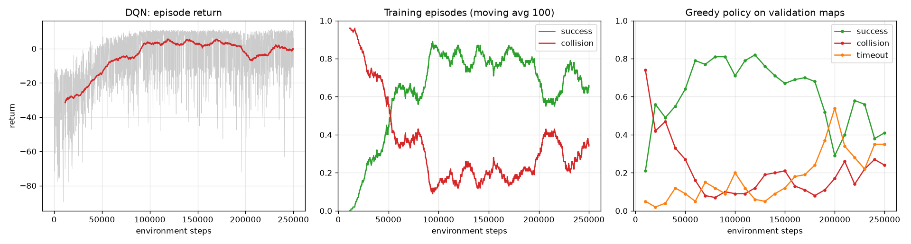
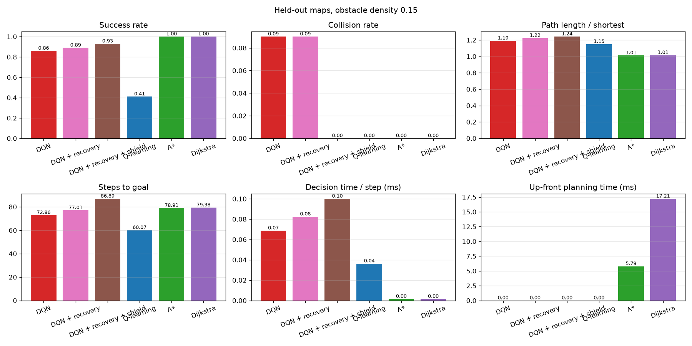
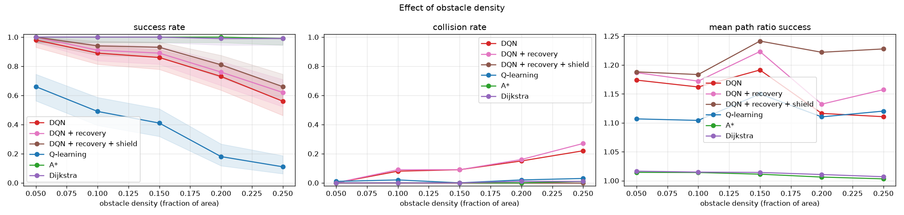

# Sim-to-Real Autonomous Robot Path Planning and Obstacle Avoidance Using Deep Reinforcement Learning

**Project report.** All numbers below are from actual program runs in this repository
(`results/RESULTS.md`, `results/safety_validation.md`, `runs/`). No physical robot was
used; real-world performance is therefore **not** reported (Section 9).

---

## 1. Objective

Train a mobile robot to drive from a start pose to a goal while avoiding obstacles,
using deep reinforcement learning in simulation, and structure the software so the
same policy can later control a physical differential-drive robot with minimal
changes, behind an independent safety layer.

## 2. System overview

```
 Policy (DQN) ─► action ─► VelocityCommand ─► SafetyLayer ─► RobotBackend ─► simulator | ROS 2 robot
      ▲                                                            │
      └──── ObservationBuilder ◄── range scan + pose ◄─────────────┘
```

* `NavigationCore` implements this loop once; it is used by the Gymnasium training
  environment **and** by the deployment controller, so observation and action
  definitions cannot differ between training and deployment.
* `RobotBackend` (hardware abstraction layer) has three implementations:
  `SimulationBackend`, `HardwareBackend` (ROS 2: `/scan`, `/odom` → `/cmd_vel`) and
  `FaultInjectionBackend` (wraps either one to simulate failures).
* Details: [docs/ARCHITECTURE.md](docs/ARCHITECTURE.md), [docs/HARDWARE.md](docs/HARDWARE.md).

## 3. Simulation

| Item | Value |
|---|---|
| Arena | 6 m × 6 m, walls on all sides |
| Static obstacles | random axis-aligned rectangles, side 0.3–1.0 m, placed until a target area fraction ("density") is covered |
| Moving obstacles (optional) | circles r = 0.2 m, 0.2 m/s, bouncing |
| Map validity | start/goal ≥ 2.5 m apart, ≥ 0.35 m clearance, connected on an occupancy grid inflated by the robot radius (BFS) |
| Robot | circular differential drive, r = 0.15 m, unicycle kinematics integrated exactly over 5 sub-steps per 0.25 s decision |
| Range sensor | 24 beams over 360°, 3 m max range, vectorised ray casting; optional Gaussian noise and beam dropout |
| Collision | robot disc overlaps an obstacle or wall → episode ends |
| Goal | robot centre within 0.3 m of the goal; time limit 400 decisions (100 s) |

## 4. Reinforcement learning formulation

**Observation (29 values, robot frame, normalised):** 24 ranges / 3 m; goal distance / arena
diagonal; sin and cos of the goal bearing relative to the heading; last linear and angular
command. No absolute coordinates are used, so the policy is map-independent and can be fed from
odometry + LiDAR on hardware.

**Actions:** forward (0.3 m/s → 7.5 cm per step), turn left / right in place (±1.2 rad/s → ±17°
per step), stop.

**Reward (final configuration):**

| Term | Value |
|---|---|
| reach goal | +10 |
| collision | −10 (terminal) |
| time penalty | −0.05 per step |
| progress | +1.0 × (decrease in goal distance, m) |
| invalid action: stop while not at goal | −0.5 |
| invalid action: left↔right reversal (dithering) | −0.1 |
| proximity (any range < 0.35 m) | −0.05 |

**DQN:** MLP 29-128-128-4 (ReLU), Double DQN, Huber loss, Adam (lr 2.5·10⁻⁴), γ = 0.99, replay
buffer 200k, batch 128, hard target update every 2000 updates, ε linearly 1.0 → 0.05 over 100k
steps, 250k environment steps (~9 min on one CPU core).

**Domain randomisation (every training episode):** new random map; density U(0.05, 0.25); wheel
calibration error (linear and angular speed scale U(0.9, 1.1)); 5 % multiplicative velocity
noise; range noise σ ~ U(0, 0.03) m; beam dropout p ~ U(0, 0.02).

**Model selection:** greedy evaluation on 100 *validation* maps every 10k steps; the checkpoint
with the highest validation success is exported. Validation maps, training maps and test maps
use disjoint seed ranges.

**Q-learning baseline:** tabular, on a 648-state discretisation of the *same* observation (8 goal
bearing sectors × 3 distance bins × 3 clearance bins for front/left/right), α = 0.1, 6000 episodes,
same reward.

**Classical baselines:** A* and Dijkstra on a 5 cm occupancy grid (8-connected, obstacles inflated
by robot radius + 0.10 m with fallback to +0.05/+0.02 m for narrow passages, line-of-sight path
smoothing). The plan is executed by a path follower that uses the *same* four discrete actions.
**These planners are given the full static map and the true pose in advance**; the RL policies only
see the 24 range readings and the goal direction. They are therefore an upper reference, not a
like-for-like competitor.

**Navigation-layer additions evaluated separately:**
* *recovery*: if the robot moves < 5 cm in 12 steps (3 s), execute 8 randomised escape actions
  (turns, forward only if the front is clear), similar to recovery behaviours in classical
  navigation stacks;
* *shield*: the safety layer (Section 7) active.

## 5. Development findings (how the final configuration was reached)

These intermediate results come from the runs in `runs/sweep` and `runs/final`.

1. **The first reward (progress ×3, time −0.01) produced loitering policies.** A 300k-step run
   reached 72 % validation success at best; almost every failure was a timeout in which the robot
   did not move at all: either alternating left/right in place (`LRLRLR…`) or stopping forever.
   Under that reward, staying in place costs almost nothing, while a detour around an obstacle
   costs immediate negative progress.
2. **A reward sweep (4 variants, 200k steps each)** showed that penalising left/right reversal
   cuts timeouts. Lowering the progress weight alone did not help.
3. **"Stop" is an absorbing fixed point for a deterministic reactive policy:** in a static world,
   stopping leaves the observation unchanged, so the policy stops again forever. With the earlier
   −0.1 stop penalty and γ = 0.99, stopping forever was valued at about −11, the same as a
   collision (−10). Raising the penalty to −0.5 (stop = invalid action) and adding the recovery
   behaviour addressed this.
4. **Training is unstable after ε reaches its floor.** In every variant the greedy validation
   success peaked around 80–120k steps and later oscillated or dropped (figure below), while
   ε-greedy training episodes stayed at 65–80 % success. Checkpoint selection on validation maps
   is therefore essential; the exported model is from step 120k (validation success 0.82).



## 6. Experiments and results

Test set: 100 unseen maps per setting (seeds 1,000,000–1,000,099), identical for every method.
95 % Wilson confidence intervals are given for the main comparison. "Path ratio" = driven length ÷
shortest feasible path to the goal circle, successful episodes only.

### 6.1 Main comparison (density 0.15)

| Method | Success [95 % CI] | Collision | Timeout | Path ratio | Steps | Decision time | Up-front planning |
|---|---|---|---|---|---|---|---|
| DQN | 0.86 [0.78, 0.91] | 0.09 | 0.05 | 1.19 | 72.9 | 0.07 ms/step | – |
| DQN + recovery | 0.89 [0.81, 0.94] | 0.09 | 0.02 | 1.22 | 77.0 | 0.08 ms/step | – |
| **DQN + recovery + shield** | **0.93 [0.86, 0.97]** | **0.00** | 0.07 | 1.24 | 86.9 | 0.10 ms/step | – |
| Q-learning | 0.41 [0.32, 0.51] | 0.00 | 0.59 | 1.15 | 60.1 | 0.04 ms/step | – |
| A* (known map) | 1.00 [0.96, 1.00] | 0.00 | 0.00 | 1.01 | 78.9 | – | 5.8 ms, 1,278 nodes |
| Dijkstra (known map) | 1.00 [0.96, 1.00] | 0.00 | 0.00 | 1.01 | 79.4 | – | 17.2 ms, 5,520 nodes |

* With only local sensing, the DQN reaches the goal on 86 % of unseen maps; the complete
  deployment configuration reaches 93 % with no collisions.
* Learned paths are 19–24 % longer than optimal: the reactive policy explores detours that a
  planner with the full map avoids (example trajectories in `results/trajectories_*.png`).
* A* and Dijkstra find paths of the same length; A* expands 4.3× fewer nodes and is 3× faster.
* Tabular Q-learning, given the same observations, mostly fails by timeout: the coarse 648-state
  discretisation aliases very different situations, so the greedy table policy gets stuck.



### 6.2 Effect of obstacle density (success / collision)

| Density | DQN | DQN + recovery | DQN + rec. + shield | Q-learning | A* |
|---|---|---|---|---|---|
| 0.05 | 0.98 / 0.00 | 1.00 / 0.00 | 1.00 / 0.00 | 0.66 / 0.01 | 1.00 / 0.00 |
| 0.10 | 0.89 / 0.08 | 0.91 / 0.09 | 0.94 / 0.00 | 0.49 / 0.02 | 1.00 / 0.00 |
| 0.15 | 0.86 / 0.09 | 0.89 / 0.09 | 0.93 / 0.00 | 0.41 / 0.00 | 1.00 / 0.00 |
| 0.20 | 0.73 / 0.15 | 0.76 / 0.16 | 0.81 / 0.00 | 0.18 / 0.02 | 1.00 / 0.00 |
| 0.25 | 0.56 / 0.22 | 0.62 / 0.27 | 0.66 / 0.00 | 0.11 / 0.03 | 0.99 / 0.01 |

Success of every learned method falls steadily with density. The shield keeps collisions at zero
at every density, but in dense maps it converts would-be collisions into timeouts (34 % at
density 0.25): the shield prevents crashes but cannot find a way through. A*'s path follower
collided once at densities 0.20 and 0.25: in the narrowest passages the planner had to fall back
to a 2 cm margin.



### 6.3 Generalisation (success / collision)

| Condition | DQN | DQN + rec. + shield | Q-learning | A* |
|---|---|---|---|---|
| unseen maps, training distribution | 0.86 / 0.09 | 0.93 / 0.00 | 0.41 / 0.00 | 1.00 / 0.00 |
| denser than any training map (0.30) | 0.55 / 0.22 | 0.61 / 0.00 | 0.07 / 0.02 | 0.95 / 0.05 |
| small clutter (0.15–0.35 m pieces) | 0.48 / 0.41 | 0.79 / 0.00 | 0.05 / 0.08 | 1.00 / 0.00 |
| long walls (1.0–2.5 m) | 0.87 / 0.09 | 0.93 / 0.00 | 0.56 / 0.00 | 1.00 / 0.00 |
| 3 moving obstacles (never in training) | 0.61 / 0.37 | 0.72 / 0.25 | 0.36 / 0.38 | 0.74 / 0.26 |

* The policy transfers to unseen maps of the training distribution and to long-wall layouts with
  no loss.
* **Small clutter is the weakest case for the raw policy (41 % collisions).** Small obstacles can
  fall between the 15°-spaced beams. The shield, which checks the swept corridor, removes all of
  these collisions and raises success to 79 %.
* Moving obstacles were never seen in training. The shield reduces but cannot eliminate collisions
  with them, because it only stops the robot's own motion and cannot dodge an obstacle that drives
  into a stationary robot. The A* plan is static and does no better (26 % collisions).

### 6.4 Sensor noise and motion uncertainty (success / collision)

| Range noise σ | DQN | DQN + rec. + shield | Q-learning |
|---|---|---|---|
| 0.00 m | 0.86 / 0.09 | 0.93 / 0.00 | 0.41 / 0.00 |
| 0.02 m | 0.86 / 0.09 | 0.94 / 0.00 | 0.48 / 0.01 |
| 0.05 m | 0.87 / 0.11 | 0.93 / 0.01 | 0.56 / 0.06 |
| 0.10 m | 0.83 / 0.14 | 0.92 / 0.01 | 0.64 / 0.06 |

| Motion noise σ | DQN | DQN + rec. + shield | Q-learning | A* follower |
|---|---|---|---|---|
| 0.00 | 0.86 / 0.09 | 0.93 / 0.00 | 0.41 / 0.00 | 1.00 / 0.00 |
| 0.05 | 0.83 / 0.13 | 0.93 / 0.00 | 0.53 / 0.04 | 1.00 / 0.00 |
| 0.10 | 0.88 / 0.11 | 0.96 / 0.00 | 0.58 / 0.02 | 1.00 / 0.00 |
| 0.20 | 0.86 / 0.14 | 0.95 / 0.00 | 0.58 / 0.03 | 1.00 / 0.00 |

* The DQN is robust to range noise up to 3× the training maximum (10 cm) and to motion noise up to
  4× the training value: success changes by at most 3 points, though collisions rise slowly with
  range noise. The shielded configuration stays at 92–96 % with ≤ 1 % collisions.
* **Noise *improves* Q-learning** (0.41 → 0.64). Noise randomises its otherwise deterministic,
  heavily aliased table policy and breaks its loops. This supports the stuck-loop diagnosis above.

### 6.5 Safety validation (fault injection, `python main.py safety-test`)

| Scenario | Result |
|---|---|
| Velocity limits | request (5.0, −9.0) clamped to (0.30, −1.50) |
| Always-forward policy towards a wall, shield on | stops 0.10 m from the wall; without shield: collision |
| Random policy, 50 maps | collisions 0/50 with shield, 46/50 without |
| Sensor stream freezes | robot stops within the 0.5 s timeout (0.225 m travelled) |
| All beams invalid | immediate stop (`sensor_fault`) |
| Communication lost, robot-side watchdog 0.5 s | 0.08 m travelled after link loss; **without** a robot-side watchdog: 1.95 m |
| Emergency stop | immediate stop, stays latched, run aborted; motion resumes only after explicit reset |
| Manual override | operator command replaces the policy command |
| Trained DQN, 100 unseen maps | collisions 0/100 with shield vs 9/100 without; success 71 vs 86 |

Two findings from this validation:
* A first version of the proximity stop used a ±35° front cone and still allowed **7/50
  collisions** by a random policy: a circular robot driving straight clips corners 50–80° to its
  side. It was replaced by a swept-corridor test, which gave 0/50.
* The link-loss scenario shows that the software safety layer cannot protect a robot that no longer
  receives its commands. A watchdog on the motor controller is mandatory (docs/HARDWARE.md).

The shield costs success when it is used **without** the recovery behaviour (86 → 71 %): blocked
forward motion leaves the policy stuck. Combining it with recovery (Section 6.1) gives 93 %
success with 0 collisions.

## 7. Safety layer design

Applied to every command, in priority order: latched emergency stop → communication loss →
sensor timeout / missing data → too few valid beams → manual override (replaces the policy) →
non-finite command rejected → reverse blocked → velocity limits → swept-corridor proximity stop
(turning in place stays allowed) → acceleration limits (speeding up only; stopping is never
delayed). The hardware backend also clamps to the robot profile limits and runs a watchdog that
publishes zero velocity if the control loop stops. The RL policy only outputs an action index and
has no path around these checks.

## 8. Sim-to-real transfer plan

Already in the software: robot-frame normalised observations; a fixed beam layout with
conservative (minimum-per-sector) resampling of real LiDAR scans; identical action definitions
loaded from the model checkpoint; domain randomisation of maps, wheel calibration, motion noise,
range noise and dropouts; a calibration procedure (`python main.py calibrate`; in simulation it
recovered hidden scale factors of 0.963/1.059 as 0.962/1.060); a separate robot profile; and
a staged hardware test procedure (docs/HARDWARE.md §5).

Expected sim-to-real gaps that are **not** modelled: odometry drift, motor dynamics and latency,
LiDAR artefacts (glass, dark surfaces), non-rectangular and moving obstacles such as people,
and floor effects.

## 9. Physical robot

No hardware was available. `HardwareBackend` is implemented against standard ROS 2 messages but is
**untested on a real robot**. Real-world performance (experiment 6 of the brief) remains future
work; docs/HARDWARE.md §8 describes how to measure it so it is comparable with simulation.

## 10. Limitations

* **Reactive, memoryless policy:** it can get trapped in dead ends and U-shaped obstacles; recovery
  only partly compensates. Success drops to 56–66 % at density 0.25.
* **Training instability** after ε reaches its floor; results depend on checkpoint selection.
  Only one training seed of the final configuration was run, so seed-to-seed variance is not
  quantified.
* **Sparse 24-beam sensing** misses small obstacles between beams (41 % collisions in clutter
  without the shield).
* **Simulation simplifications:** perfect pose, instant velocity response, rectangular static
  obstacles, 2D only.
* **Unequal baselines:** the classical planners know the map; a fair "unknown map" baseline (e.g.
  A* with online mapping or D* Lite) was not implemented.

## 11. Future work

Recurrent or frame-stacked observations (memory to escape dead ends); continuous-action methods
(SAC/TD3) for smoother motion; more beams or a learned occupancy input; dynamic obstacles in
training; multiple seeds and longer training with learning-rate decay; a D* Lite/online-mapping
baseline; Gazebo + ROS 2 simulation of a TurtleBot3 as an intermediate step; and real-robot trials
following docs/HARDWARE.md.

## 12. Reproducing

```bash
pip install -r requirements.txt
python main.py train-dqn                 # final config is the default (~9 min)
python main.py train-qlearning
python main.py experiments --dqn-run runs/<dqn run> --q-run runs/<q run>
python main.py safety-test
python -m pytest tests
python main.py demo
```
The trained models used in this report are `models/dqn.pt` (run `runs/final/B`, step 120k) and
`models/qlearning.pt` (run `runs/final/Q`).
