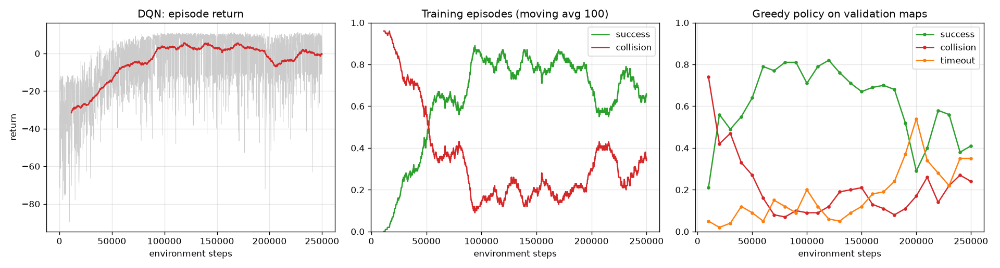
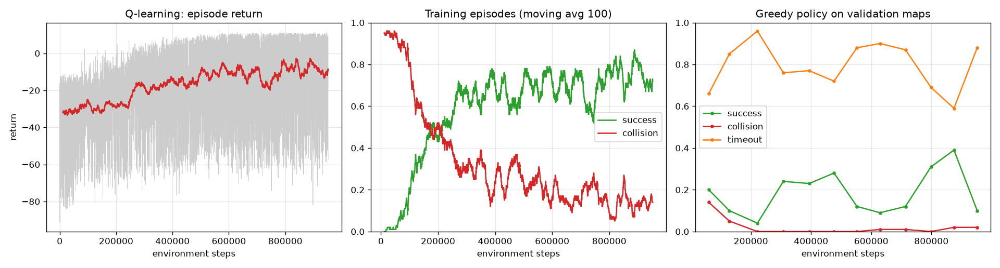
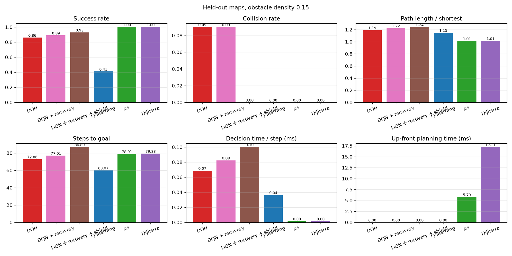
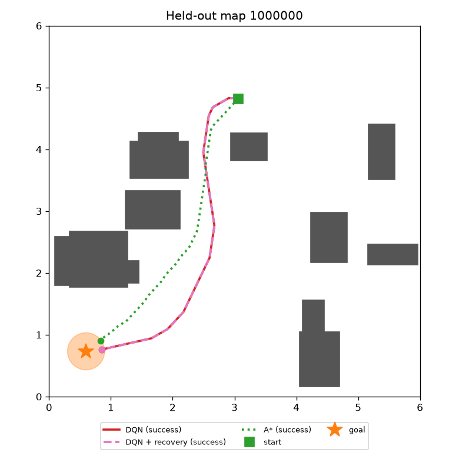
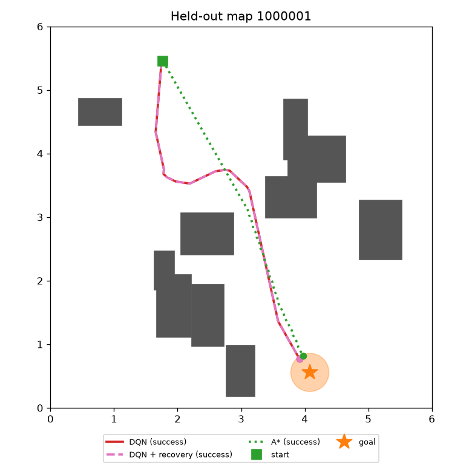
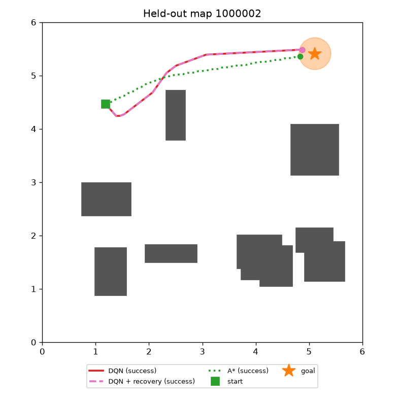
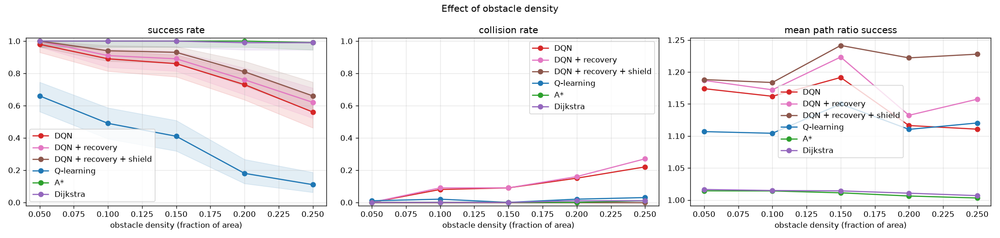
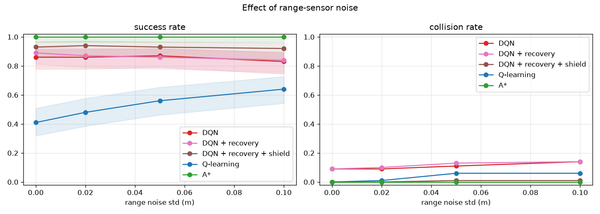
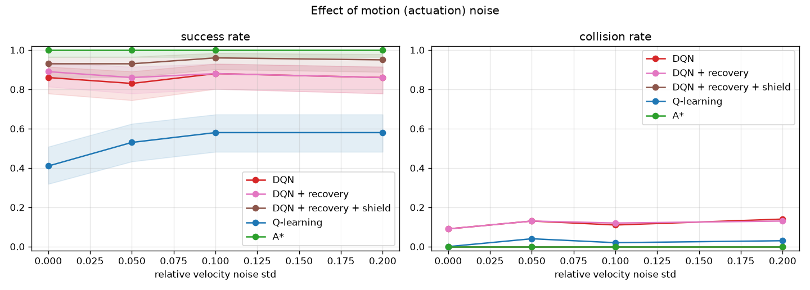
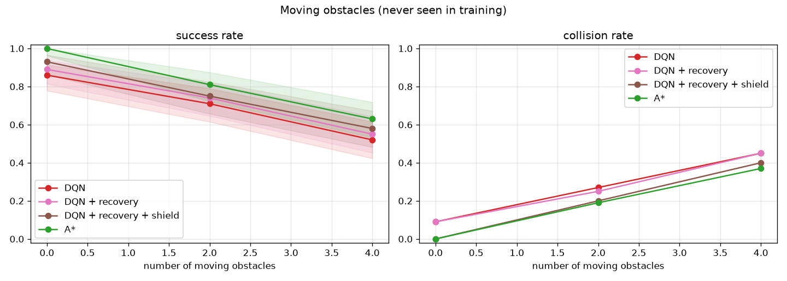

# Experiment results

Generated by `python main.py experiments` on 2026-10-15 22:56.
100 held-out maps per setting (seeds 1000000-1000099), identical for every method. "+ recovery" = navigation-layer stuck recovery around the same DQN; "+ shield" = safety layer active (the full deployment configuration).

## 1. Training progress

## 2. Method comparison (density 0.15, 100 unseen maps)

A* / Dijkstra are given the full static map and the true pose; DQN and Q-learning only see 24 range readings plus goal distance/bearing. Path ratio = driven length / shortest path to the goal circle (successful episodes only).

| Method | Success | CI low | CI high | Collision | Timeout | Path ratio | Steps | Decision ms/step | Planning ms | Nodes expanded |
|---|---|---|---|---|---|---|---|---|---|---|
| DQN | 0.86 | 0.78 | 0.91 | 0.09 | 0.05 | 1.19 | 72.86 | 0.07 | 0.00 | 0.00 |
| DQN + recovery | 0.89 | 0.81 | 0.94 | 0.09 | 0.02 | 1.22 | 77.01 | 0.08 | 0.00 | 0.00 |
| DQN + recovery + shield | 0.93 | 0.86 | 0.97 | 0.00 | 0.07 | 1.24 | 86.89 | 0.10 | 0.00 | 0.00 |
| Q-learning | 0.41 | 0.32 | 0.51 | 0.00 | 0.59 | 1.15 | 60.07 | 0.04 | 0.00 | 0.00 |
| A* | 1.00 | 0.96 | 1.00 | 0.00 | 0.00 | 1.01 | 78.91 | 0.00 | 5.79 | 1277.81 |
| Dijkstra | 1.00 | 0.96 | 1.00 | 0.00 | 0.00 | 1.01 | 79.38 | 0.00 | 17.21 | 5519.99 |

Example trajectories on held-out maps:

  

## 3. Effect of obstacle density

Training used densities sampled from [0.05, 0.25].

| Density | Method | Success | Collision | Timeout | Path ratio |
|---|---|---|---|---|---|
| 0.05 | DQN | 0.98 | 0.00 | 0.02 | 1.17 |
| 0.05 | DQN + recovery | 1.00 | 0.00 | 0.00 | 1.19 |
| 0.05 | DQN + recovery + shield | 1.00 | 0.00 | 0.00 | 1.19 |
| 0.05 | Q-learning | 0.66 | 0.01 | 0.33 | 1.11 |
| 0.05 | A* | 1.00 | 0.00 | 0.00 | 1.01 |
| 0.05 | Dijkstra | 1.00 | 0.00 | 0.00 | 1.02 |
| 0.10 | DQN | 0.89 | 0.08 | 0.03 | 1.16 |
| 0.10 | DQN + recovery | 0.91 | 0.09 | 0.00 | 1.17 |
| 0.10 | DQN + recovery + shield | 0.94 | 0.00 | 0.06 | 1.18 |
| 0.10 | Q-learning | 0.49 | 0.02 | 0.49 | 1.10 |
| 0.10 | A* | 1.00 | 0.00 | 0.00 | 1.01 |
| 0.10 | Dijkstra | 1.00 | 0.00 | 0.00 | 1.01 |
| 0.15 | DQN | 0.86 | 0.09 | 0.05 | 1.19 |
| 0.15 | DQN + recovery | 0.89 | 0.09 | 0.02 | 1.22 |
| 0.15 | DQN + recovery + shield | 0.93 | 0.00 | 0.07 | 1.24 |
| 0.15 | Q-learning | 0.41 | 0.00 | 0.59 | 1.15 |
| 0.15 | A* | 1.00 | 0.00 | 0.00 | 1.01 |
| 0.15 | Dijkstra | 1.00 | 0.00 | 0.00 | 1.01 |
| 0.20 | DQN | 0.73 | 0.15 | 0.12 | 1.12 |
| 0.20 | DQN + recovery | 0.76 | 0.16 | 0.08 | 1.13 |
| 0.20 | DQN + recovery + shield | 0.81 | 0.00 | 0.19 | 1.22 |
| 0.20 | Q-learning | 0.18 | 0.02 | 0.80 | 1.11 |
| 0.20 | A* | 1.00 | 0.00 | 0.00 | 1.01 |
| 0.20 | Dijkstra | 0.99 | 0.01 | 0.00 | 1.01 |
| 0.25 | DQN | 0.56 | 0.22 | 0.22 | 1.11 |
| 0.25 | DQN + recovery | 0.62 | 0.27 | 0.11 | 1.16 |
| 0.25 | DQN + recovery + shield | 0.66 | 0.00 | 0.34 | 1.23 |
| 0.25 | Q-learning | 0.11 | 0.03 | 0.86 | 1.12 |
| 0.25 | A* | 0.99 | 0.01 | 0.00 | 1.00 |
| 0.25 | Dijkstra | 0.99 | 0.01 | 0.00 | 1.01 |

## 4. Generalisation to unseen and out-of-distribution maps

No evaluation map was used in training. The out-of-distribution conditions change map statistics beyond anything in training (moving obstacles were never present in training). A* plans on the static map only, so it cannot anticipate moving obstacles.

| Condition | Method | Success | Collision | Timeout | Path ratio |
|---|---|---|---|---|---|
| in-distribution (unseen maps) | DQN | 0.86 | 0.09 | 0.05 | 1.19 |
| in-distribution (unseen maps) | DQN + recovery | 0.89 | 0.09 | 0.02 | 1.22 |
| in-distribution (unseen maps) | DQN + recovery + shield | 0.93 | 0.00 | 0.07 | 1.24 |
| in-distribution (unseen maps) | Q-learning | 0.41 | 0.00 | 0.59 | 1.15 |
| in-distribution (unseen maps) | A* | 1.00 | 0.00 | 0.00 | 1.01 |
| denser than training (0.30) | DQN | 0.55 | 0.22 | 0.23 | 1.11 |
| denser than training (0.30) | DQN + recovery | 0.55 | 0.38 | 0.07 | 1.09 |
| denser than training (0.30) | DQN + recovery + shield | 0.61 | 0.00 | 0.39 | 1.20 |
| denser than training (0.30) | Q-learning | 0.07 | 0.02 | 0.91 | 1.09 |
| denser than training (0.30) | A* | 0.95 | 0.05 | 0.00 | 1.00 |
| small clutter (0.15-0.35 m) | DQN | 0.48 | 0.41 | 0.11 | 1.03 |
| small clutter (0.15-0.35 m) | DQN + recovery | 0.51 | 0.49 | 0.00 | 1.07 |
| small clutter (0.15-0.35 m) | DQN + recovery + shield | 0.79 | 0.00 | 0.21 | 1.18 |
| small clutter (0.15-0.35 m) | Q-learning | 0.05 | 0.08 | 0.87 | 1.05 |
| small clutter (0.15-0.35 m) | A* | 1.00 | 0.00 | 0.00 | 1.00 |
| long walls (1.0-2.5 m) | DQN | 0.87 | 0.09 | 0.04 | 1.21 |
| long walls (1.0-2.5 m) | DQN + recovery | 0.87 | 0.09 | 0.04 | 1.21 |
| long walls (1.0-2.5 m) | DQN + recovery + shield | 0.93 | 0.00 | 0.07 | 1.25 |
| long walls (1.0-2.5 m) | Q-learning | 0.56 | 0.00 | 0.44 | 1.14 |
| long walls (1.0-2.5 m) | A* | 1.00 | 0.00 | 0.00 | 1.01 |
| 3 moving obstacles | DQN | 0.61 | 0.37 | 0.02 | 1.21 |
| 3 moving obstacles | DQN + recovery | 0.61 | 0.38 | 0.01 | 1.21 |
| 3 moving obstacles | DQN + recovery + shield | 0.72 | 0.25 | 0.03 | 1.25 |
| 3 moving obstacles | Q-learning | 0.36 | 0.38 | 0.26 | 1.16 |
| 3 moving obstacles | A* | 0.74 | 0.26 | 0.00 | 1.01 |

## 5. Sensor noise and motion uncertainty

Training randomised sensor noise in [0.0, 0.03] m and motion noise 0.05. A* uses the true map and true pose, so range noise does not affect it; motion noise affects its path follower.

### Range sensor noise

| Noise std (m) | Method | Success | Collision | Timeout |
|---|---|---|---|---|
| 0.00 | DQN | 0.86 | 0.09 | 0.05 |
| 0.00 | DQN + recovery | 0.89 | 0.09 | 0.02 |
| 0.00 | DQN + recovery + shield | 0.93 | 0.00 | 0.07 |
| 0.00 | Q-learning | 0.41 | 0.00 | 0.59 |
| 0.00 | A* | 1.00 | 0.00 | 0.00 |
| 0.02 | DQN | 0.86 | 0.09 | 0.05 |
| 0.02 | DQN + recovery | 0.87 | 0.10 | 0.03 |
| 0.02 | DQN + recovery + shield | 0.94 | 0.00 | 0.06 |
| 0.02 | Q-learning | 0.48 | 0.01 | 0.51 |
| 0.02 | A* | 1.00 | 0.00 | 0.00 |
| 0.05 | DQN | 0.87 | 0.11 | 0.02 |
| 0.05 | DQN + recovery | 0.86 | 0.13 | 0.01 |
| 0.05 | DQN + recovery + shield | 0.93 | 0.01 | 0.06 |
| 0.05 | Q-learning | 0.56 | 0.06 | 0.38 |
| 0.05 | A* | 1.00 | 0.00 | 0.00 |
| 0.10 | DQN | 0.83 | 0.14 | 0.03 |
| 0.10 | DQN + recovery | 0.84 | 0.14 | 0.02 |
| 0.10 | DQN + recovery + shield | 0.92 | 0.01 | 0.07 |
| 0.10 | Q-learning | 0.64 | 0.06 | 0.30 |
| 0.10 | A* | 1.00 | 0.00 | 0.00 |

### Motion noise

| Noise std | Method | Success | Collision | Timeout |
|---|---|---|---|---|
| 0.00 | DQN | 0.86 | 0.09 | 0.05 |
| 0.00 | DQN + recovery | 0.89 | 0.09 | 0.02 |
| 0.00 | DQN + recovery + shield | 0.93 | 0.00 | 0.07 |
| 0.00 | Q-learning | 0.41 | 0.00 | 0.59 |
| 0.00 | A* | 1.00 | 0.00 | 0.00 |
| 0.05 | DQN | 0.83 | 0.13 | 0.04 |
| 0.05 | DQN + recovery | 0.86 | 0.13 | 0.01 |
| 0.05 | DQN + recovery + shield | 0.93 | 0.00 | 0.07 |
| 0.05 | Q-learning | 0.53 | 0.04 | 0.43 |
| 0.05 | A* | 1.00 | 0.00 | 0.00 |
| 0.10 | DQN | 0.88 | 0.11 | 0.01 |
| 0.10 | DQN + recovery | 0.88 | 0.12 | 0.00 |
| 0.10 | DQN + recovery + shield | 0.96 | 0.00 | 0.04 |
| 0.10 | Q-learning | 0.58 | 0.02 | 0.40 |
| 0.10 | A* | 1.00 | 0.00 | 0.00 |
| 0.20 | DQN | 0.86 | 0.14 | 0.00 |
| 0.20 | DQN + recovery | 0.86 | 0.13 | 0.01 |
| 0.20 | DQN + recovery + shield | 0.95 | 0.00 | 0.05 |
| 0.20 | Q-learning | 0.58 | 0.03 | 0.39 |
| 0.20 | A* | 1.00 | 0.00 | 0.00 |

## 6. Moving obstacles

| Moving obstacles | Method | Success | Collision | Timeout |
|---|---|---|---|---|
| 0 | DQN | 0.86 | 0.09 | 0.05 |
| 0 | DQN + recovery | 0.89 | 0.09 | 0.02 |
| 0 | DQN + recovery + shield | 0.93 | 0.00 | 0.07 |
| 0 | A* | 1.00 | 0.00 | 0.00 |
| 2 | DQN | 0.71 | 0.27 | 0.02 |
| 2 | DQN + recovery | 0.74 | 0.25 | 0.01 |
| 2 | DQN + recovery + shield | 0.75 | 0.20 | 0.05 |
| 2 | A* | 0.81 | 0.19 | 0.00 |
| 4 | DQN | 0.52 | 0.45 | 0.03 |
| 4 | DQN + recovery | 0.55 | 0.45 | 0.00 |
| 4 | DQN + recovery + shield | 0.58 | 0.40 | 0.02 |
| 4 | A* | 0.63 | 0.37 | 0.00 |

